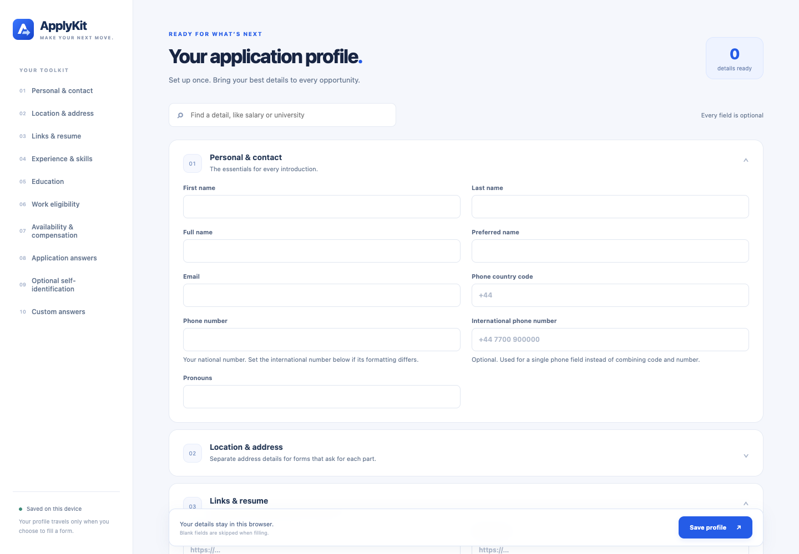

<p align="center"></p>
<h1 align="center">ApplyKit</h1>
<p align="center"><strong>Make your next move.</strong><br>A personal application toolkit for Chrome. Save your details once, review matching fields, and bring them to your next application.</p>



## What it does

- A blue profile workspace with search, collapsible sections, a saved-detail count, and reminders for unsaved changes.
- Optional fields for contact details, full address, social links, resume, recent experience, education, work eligibility, availability, compensation, and reusable application answers.
- Up to 100 custom questions and answers for details unique to your search.
- A popup that previews matching empty fields before filling. It handles native text inputs, text areas, dropdowns, and radio answers.
- Local PDF storage, download, replacement, and removal. Recognized resume inputs can receive the PDF when you confirm the fill action.
- Undo for the last fill on the current page. Answers you edit afterward are preserved.
- JSON profile export/import, including older ApplyKit backups.

All fields are optional. A company-specific answer is a draft to review, especially motivation, salary, work eligibility, and sponsorship. The experience and education sections describe your most recent role and qualification; use custom answers for additional details.

## Install in Chrome — no build or store required

1. [Download this repository as a ZIP](https://github.com/WorkWithAfridi/ApplyKit/archive/refs/heads/main.zip) and extract it, or clone it:
   ```sh
   git clone https://github.com/WorkWithAfridi/ApplyKit.git
   ```
2. Type `chrome://extensions` into Chrome’s address bar.
3. Switch **Developer mode** on in the top-right corner.
4. Click **Load unpacked** in the top-left corner.
5. Select the extracted or cloned folder containing `manifest.json` — not the ZIP file or its parent directory.
6. Open Chrome’s puzzle-piece Extensions menu and pin **ApplyKit**.

If ApplyKit does not appear, confirm that the selected folder directly contains `manifest.json`. Keep that folder on your computer while using the extension.

### Update an existing installation

Pull the latest changes, or replace your extracted source folder with the new version. At `chrome://extensions`, find the **ApplyKit** card and click its circular **Reload** arrow. Reload any open ApplyKit settings page afterward. Updating the same installed extension preserves its stored profile and PDF. Removing and reinstalling it may clear that data.

## Set up your profile

Open ApplyKit and choose **Edit**. Fill any details you want to reuse and click **Save profile**. You can also use Command/Ctrl + S. Use the section navigation or search to find a field quickly.

| Section | Details you can keep ready |
| --- | --- |
| Personal & contact | Names, email, national and international phone numbers, calling code, pronouns |
| Location & address | Street lines, city, state/province, postcode, country, time zone |
| Links & resume | LinkedIn, portfolio, GitHub, another link, CV URL, stored PDF |
| Experience & skills | Recent title and employer, employment dates, experience years, skills, languages, summary |
| Education | School, degree, field of study, graduation year, grade, certifications |
| Work eligibility | Authorization, sponsorship, relocation, travel, desired title, employment type, work arrangement |
| Availability & compensation | Start date, notice period, expected/current salary, currency, pay period |
| Application answers | Cover letter draft, role/company motivation, achievements, referrals, additional information |
| Optional self-identification | Birth date, nationality, gender, ethnicity, disability and veteran status |
| Custom answers | Your own question labels and reusable answers |

Self-identification answers are excluded from filling unless you explicitly enable the checkbox in that section. Leave anything you do not want to store blank.

### Phone numbers

Save the calling code separately, such as `+44`. ApplyKit uses a separate native calling-code control when it finds one; if that control already contains a different code, it skips the phone number. Native fields marked as a national number keep the national value.

For a single combined phone field, an optional **International phone number** takes priority. Otherwise, ApplyKit combines your calling code and phone number. It preserves the digits you save and does not infer country-specific trunk-prefix rules, so use the international field for exact formatting. Custom country-picker widgets may need manual selection.

### Resume PDF

Choose a PDF under **Links & resume**. The file is saved immediately in the browser, separately from the profile Save button. PDFs must be smaller than 10 MB. You can download or remove the stored file here.

During preview, ApplyKit lists **Resume PDF** only if it finds an empty resume/CV upload input that accepts PDFs. The PDF bytes are supplied to that page only when you confirm filling. Some custom upload controls and cross-origin embedded forms need manual attachment. A resume URL can fill a separate link field.

## Fill a form

1. Open a job application page and click ApplyKit.
2. Choose **Review matching fields**.
3. Check the list, then click **Fill … matched fields**.
4. Inspect the page, tailor any draft answers, and submit the application yourself.

Existing answers are preserved. If a field changes after preview, it is skipped. ApplyKit does not check consent boxes, enter passwords, solve CAPTCHAs, or submit forms. Matching prefers explicit autocomplete attributes and specific field labels. Unknown or ambiguous matches are skipped.

Choose **Undo last fill** to restore fields still holding ApplyKit’s last values. After closing and reopening the popup, review matches to reveal Undo again. Undo is available while the current page remains loaded; it restores visible fields, but cannot retract a PDF that a website has already processed.

## Privacy and backups

- Profile fields use Chrome’s `storage.local`; the PDF uses extension IndexedDB. Nothing is synced to a cloud account or sent to an ApplyKit service.
- Profile data and the PDF stay outside the source tree. There are no real applicant details in this repository.
- Fill actions intentionally share the selected profile values and PDF with the application page. Sites may process field changes or attachments immediately, even before final submission.
- **Export JSON** backs up saved profile fields and custom answers. It does not contain the PDF; keep the original separately. Import replaces profile fields after confirmation and leaves the stored PDF as it is.
- JSON backups contain personal details. Do not commit your backups, PDF, or application screenshots to the repository.
- Uninstalling the extension or clearing browser data can remove the stored information.

## Permissions and compatibility

| Permission | Why it is needed |
| --- | --- |
| `storage` | Store and retrieve profile settings locally. |
| `activeTab` + `scripting` | Review and fill the current page after you invoke ApplyKit. |

There is no background page scanning, analytics, remote font loading, or all-sites host permission. Native controls in same-origin frames and open shadow roots are supported. Chrome internal pages, closed shadow roots, cross-origin frames, rich-text editors, complex custom dropdowns, and multi-step controls may require manual entry. No extension can recognize every application form reliably; review each result.

## Development

The extension runs directly from these files. Node.js, pnpm, and Chrome are only needed for the development checks:

```sh
pnpm install --frozen-lockfile
pnpm test
```

The browser checks use installed Google Chrome in headless mode and fictional test data. They cover field disambiguation, phone handling, preview/undo, PDF attachment, native menus/radios, same-origin frames, shadow roots, legacy import, local PDF persistence, and responsive layouts. Set `APPLYKIT_CHROME_CHANNEL=chromium` to use a Playwright-managed Chromium installation instead.

| File | Purpose |
| --- | --- |
| `schema.js` | Shared field definitions, section labels, and matching aliases |
| `options.html`, `options.js` | Profile workspace, backup/import, and PDF management |
| `popup.html`, `popup.js` | Profile overview and review/fill/undo flow |
| `autofill.js` | Isolated-world matching, filling, and undo |
| `storage.js` | Browser-local PDF persistence |
| `styles.css`, `assets/` | Blue theme and logo/icon assets |

## Contributing

Issues and pull requests are welcome. When reporting a missed field, share its label, control type, and a fictional example; avoid posting real applicant data or application URLs containing access tokens. Add a focused regression check when changing matching behavior. Keep Chrome permissions limited to what the feature requires.

Further improvements could include user-approved site mappings, multiple job-search profiles, and structured lists of past roles and qualifications. These are not part of the current release.

See [BRANDING.md](BRANDING.md) for logo assets and colors.

## License

[MIT](LICENSE).
